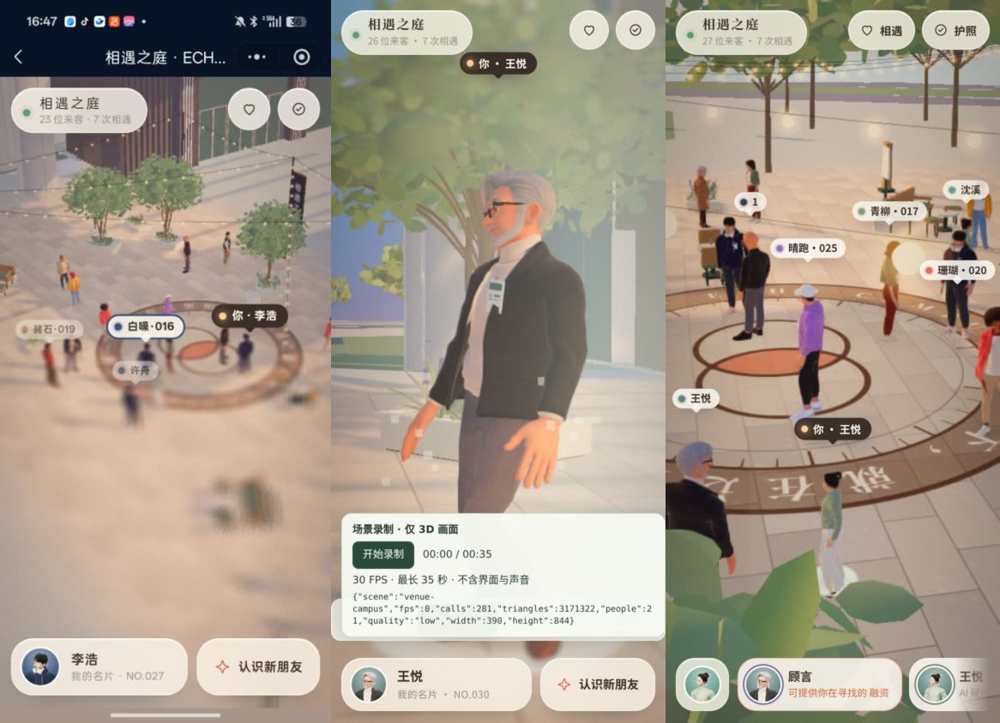
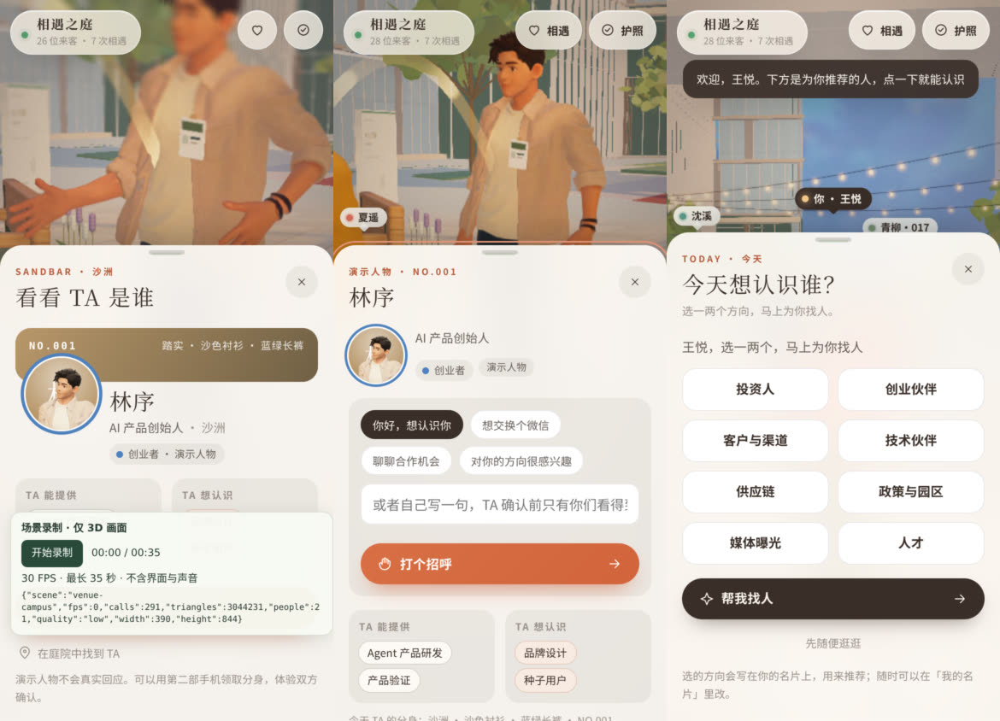
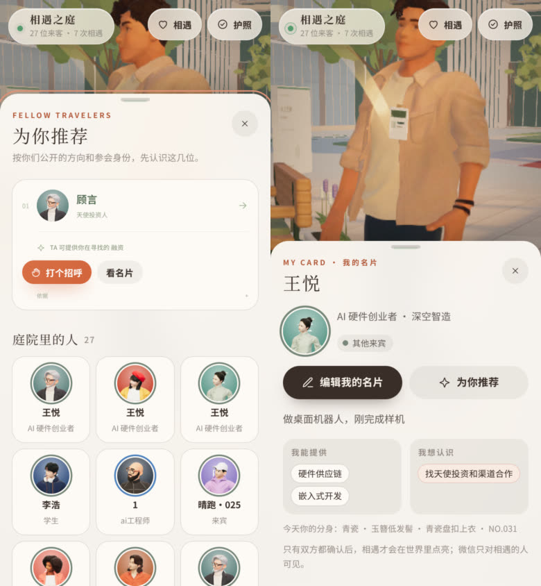
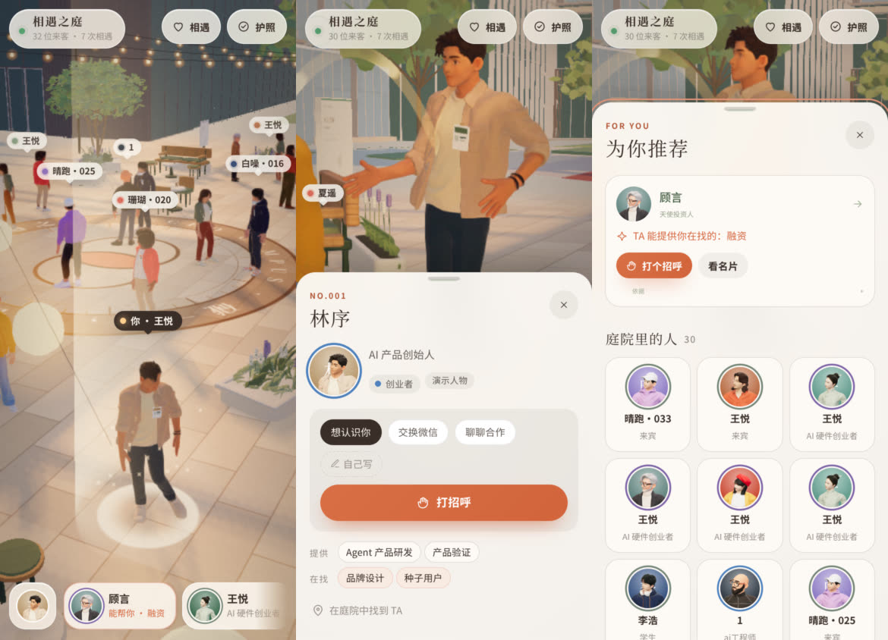

# 相遇之庭 · 来宾体验 v2（2026-10-19）

**一句话**：碰一下进来，先看清楚这里有谁、该先认识谁、为什么，再一步打出招呼；画面不再糊。

预览：`https://capture.meetmind.online/echo-campus-preview/`（分支 `codex/echo-campus-ux-20261019`，独立服务和数据副本；线上 `/echo-campus/` 未改）。

## 1. 用户是谁，来干什么

10-24 的科创嘉年华暨 OPC 超级个体挑战赛总决赛：一人公司创业者、投资人、园区与政府、平台伙伴、媒体、观众。现场嘈杂、时间碎，掏出手机的十几秒里，他们只想知道三件事：

1. 这里有谁值得我认识？
2. 为什么是 TA？
3. 怎么开口不尴尬？

活动后的问题是：我今天认识了谁，怎么联系。地图的价值就是把这几件事做得比满场找人更快。

## 2. 改前实测（手机 390×844，微信小程序 UA，呆猫换票进场）

左：真机截图；中：改前；右：改后。

| # | 问题 | 原因 |
| --- | --- | --- |
| 1 | 下半屏糊成一片、人物重影（“虚影”） | 移轴模糊每像素 16 个固定螺旋采样点，半径随屏幕高度放大，竖屏 3 倍屏上约 30 像素：采样点间隔十几像素，边缘被复印成十几份。模糊从对焦线往上下加重，竖屏下半部正是离镜头最近、最大的人 |
| 2 | 进场后只看到自己，整屏发灰 | 落地镜头是“特写”档（模糊 0.9）且之后不再切回；特写档再叠加 2.0 的暗部提亮 |
| 3 | 推荐常常为空 | 进场不问“想认识谁”；线上 9 位真实来宾 0 人填过。词表只有 24 个话题，没有硬件、供应链、政策、媒体；最多推 3 位 |
| 4 | 不知道该点谁、点不中 | 标签只有名字或代号；手机上的人物只有几像素宽 |
| 5 | 名片先讲戏服，招呼要三步 | 卡片先展示形象特征，“能提供/想认识”和“想认识 TA”在下方；点开后再选一句、再发送；镜头把头切掉 |
| 6 | 右上角两个无字图标 | 看不出是“相遇”和“护照” |

## 3. 设计原则

- **目的先行**：每一屏回答“下一步做什么”。
- **一步完成**：招呼默认已选好一句，一点就发；推荐列表里也能直接打招呼。
- **手指友好**：名字标签本身可点（热区约 44px）；底部 2D 名单兜底 3D 点选。
- **理由透明**：每条推荐理由都来自双方公开的名片，可以核对，不用大模型。
- **氛围不抢内容**：竖屏不移轴，特写只轻柔化边缘。

## 4. 改了什么

左：改前名片；中：改后名片；右：没填方向的人进场后的一个问题。

| 问题 | 改法 | 位置 |
| --- | --- | --- |
| 1 虚影 | 模糊半径按像素计算并封顶（5 个屏幕像素），每像素随机旋转采样盘：不再有重影 | `src/runtime/CourtLook.js` |
| 1、2 竖屏 | 竖屏专用档位：漫游不模糊，特写 0.3、对焦带更宽、提亮 0.6 | `COURT_SHOTS_PORTRAIT` |
| 2 进场 | 落地特写 3 秒后，镜头退到身后、朝向人群（`hereShot`） | `src/main.js` |
| 3 推荐 | 没填方向的人进场后问一次“今天想认识谁”（8 个大按钮，可跳过）；推荐 v2：话题重合 + 身份互补（投资人↔创业者、创业者↔平台/媒体、创业者之间）+ 在场优先，已相遇的不再推荐，最多 8 位；词表新增 6 个方向 | `server/store.mjs`、`src/shared/topics.mjs`、`intentView` |
| 4 找人 | 底部推荐坞：先列为你推荐的人（带理由），再列其他人，点一下镜头飞过去并打开名片；推荐的人标签优先显示并带身份；标签可点；已相遇的人标记不同 | `dockView`、`src/runtime/WorldLabels.js` |
| 5 名片 | 顺序改为：身份/机构 → 为什么值得认识 → 打招呼（默认一句，一点发出）→ 简介与供需 → 今天的分身；竖屏镜头退远，头不再被切 | `personView`、`src/runtime/ProfileFraming.js` |
| 6 入口 | “相遇”“护照”带文字 | `AppUI.shell()` |

## 5. 留存与后端

**已做**

- 推荐 v2（见上），理由可核对。
- 呆猫用户资料同步一份到我们这边（`POST /api/partner/members`），换票带来的资料也记一份。
- `scripts/event-report.mjs`：活动漏斗报表，只出数字——来宾、填方向率、打招呼数、接受率、至少认识 1 人的比例、从招呼到确认的中位时间、最想认识/最能提供的方向、呆猫同步人数、打卡。
- `scripts/mobile-journey.mjs`：手机旅程截图回归，每次改版前后各跑一遍。

**建议下一步**（按投入产出排序）

1. 活动后名片夹：从呆猫活动页再次进入，直接看到“我的相遇”和联系方式（数据按约定期限保留）。
2. 相遇卡片：确认相遇后生成一张可长按保存的图（双方头像 + 活动名 + “我们在科创嘉年华相遇”），带小程序码，作为传播入口。
3. 确认提醒：对方接受时经呆猫订阅消息推送，需要呆猫配合。
4. 跨活动身份：同一呆猫 uid 下次活动带着名片和方向直接进入，推荐从第一秒就有。
5. 现场运营：大屏“刚刚相遇”滚动；主持人口播“打开地图，看看为你推荐的人”；签到台引导先选“今天想认识谁”。

**要看的指标**：入场 → 填方向（目标 ≥60%）→ 打招呼（≥40%）→ 接受（≥50%）→ 至少认识 1 人（≥30%）；活动后 7 天回访。

## 6. 上线

预览确认后：合并到线上分支 → 在线上检出重建 `dist/` → 重启 `echo-campus-b2b`（数据不动，重启前备份）→ 手机走一遍。回滚：切回上一个提交并重启。活动前另需：切换正式活动配置、清理测试来宾、换成真实打卡点位。

**后续**：推荐页里，给没填方向的人的旧版“选话题”表单（30 多个话题 + 勾选同意）与“今天想认识谁”重复，可统一成同一组按钮（需同步改 `ui-integration` 里对应的测试）。

## 7. v2.1（同日）：减字

- 名片：去掉“为什么值得认识”标题和框，理由直接一行；招呼改成三个短句（想认识你 / 交换微信 / 聊聊合作）+「自己写」，按钮只写“打招呼”；“提供 / 在找”两行标签，空的不显示；去掉分身描述和说明段落。
- 推荐坞：理由压成标签（“能帮你 · 融资”“投资人”）。
- 面板：去掉副标题和底部说明；英文小标题只留一个词；欢迎提示只说“欢迎，名字”。
- “今天想认识谁”：只留 8 个选项、一个按钮、一行小字。
- 进场镜头：退镜头前避开签到立牌，等落地动画结束再退；来宾已经自己拖动画面就不抢镜头。
